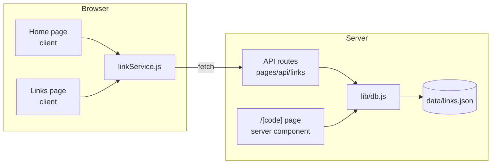
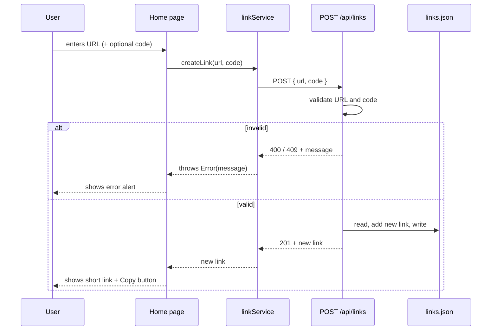
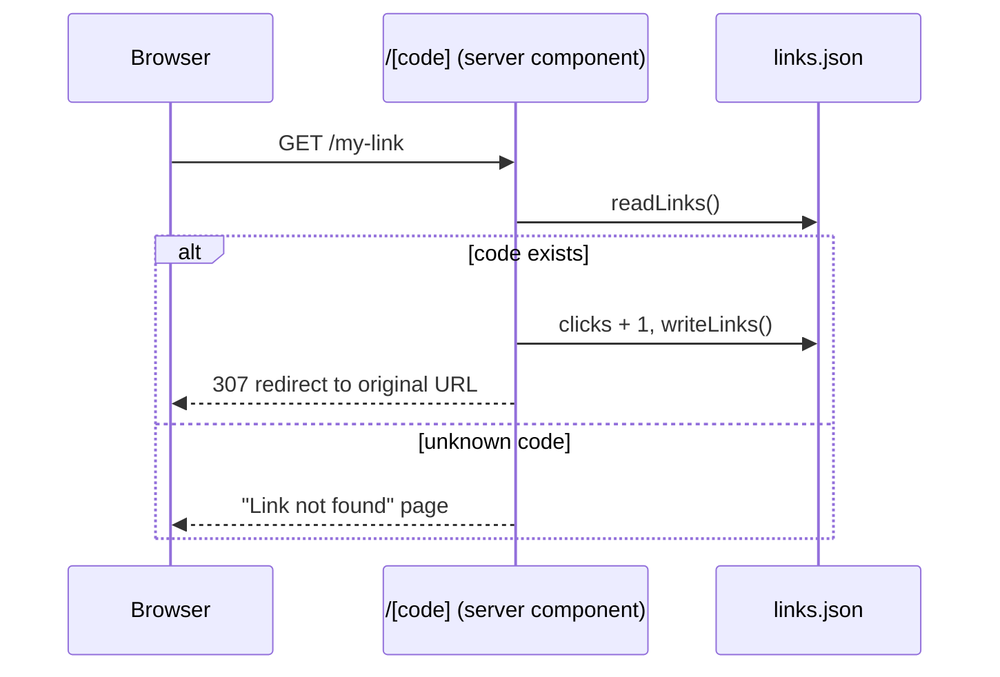

# ✂️ Route Snipper

**A full-stack link shortener built with Next.js: its own REST API, request validation, click tracking and a React Bootstrap UI. No external backend.**


Paste a long URL and get a short code like `localhost:3000/my-link`. When someone opens the short link, the app counts the click and redirects them to the original page. A dashboard lists every link with its clicks and has live search and delete.

---

## Why I built it

Most of my frontend projects call someone else's API. Here I wanted to build **both sides**: design the API myself, validate what comes in, send correct status codes, and then use that API from the frontend in a clean way.

The project shows that I can:

- design and build **REST API routes** in Next.js (`POST`, `GET`, `DELETE`, with query and dynamic parameters)
- **validate requests on the server** and answer with the right HTTP status codes (`201`, `400`, `404`, `405`, `409`)
- choose between **server and client components**, and explain why
- keep all API calls in **one service layer** instead of spreading `fetch` across components
- build a **debounced search** that calls the API only when the user stops typing
- use **environment variables** for configuration
- **test an API** with a Postman collection that checks every status code

---

## Features

| | |
| --- | --- |
| 🔗 **Shorten** | Random, unique 6-character code, or your own custom code (`my-link`) |
| 📋 **Copy** | One click copies the short link to the clipboard |
| ↪️ **Redirect** | `/{code}` adds one click and redirects to the original URL |
| 📊 **Dashboard** | `/links` shows every link with its clicks and creation date |
| 🔍 **Live search** | Search by URL or code, debounced to 400 ms |
| 🗑️ **Delete** | Removes the link on the server and from the list right away |
| ✅ **Validation** | Clear error messages from the API, shown in the UI |
| 🚫 **Not found** | Unknown codes show a friendly 404 page |

---

## How it works

### Architecture



Client components never touch the file. They call the API through the service, and only server code (API routes and the `/[code]` server component) reads and writes data through `lib/db.js`.

### Creating a short link



### Opening a short link



---

## API

All routes live in `src/pages/api/links`. Errors always have the same shape: `{ "message": "..." }`.

| Method | Endpoint | Description | Success | Errors |
| --- | --- | --- | --- | --- |
| `POST` | `/api/links` | Create a short link | `201` | `400`, `409` |
| `GET` | `/api/links?search=` | List links, optional search by URL or code (case-insensitive) | `200` | |
| `GET` | `/api/links/:code` | Get one link | `200` | `404` |
| `DELETE` | `/api/links/:code` | Delete a link | `200` | `404` |
| any other | | | | `405` |

### Example: create a link

```http
POST /api/links
Content-Type: application/json

{ "url": "https://github.com/adelhokulic", "code": "my-github" }
```

```http
HTTP/1.1 201 Created

{
  "code": "my-github",
  "url": "https://github.com/adelhokulic",
  "clicks": 0,
  "createdAt": "2026-11-24T17:46:27.842Z"
}
```

### Example: validation errors

```http
POST /api/links   { "url": "github.com" }
→ 400  { "message": "URL must start with http:// or https://." }

POST /api/links   { "url": "https://github.com", "code": "my-github" }
→ 409  { "message": "This code is already taken." }
```

### Validation rules

The checks run from the cheapest to the most expensive, so a bad request is rejected before the file is even opened.

| # | Rule | Status |
| --- | --- | --- |
| 1 | `url` is required | `400` |
| 2 | `url` starts with `http://` or `https://` | `400` |
| 3 | `url` is a real URL (`new URL()` must not throw) | `400` |
| 4 | `code`, if sent: 3-20 characters, only letters, numbers and hyphens | `400` |
| 5 | `code`, if sent: not already used | `409` |

---

## Code highlights

**Unique random code.** If the generated code already exists, a new one is drawn until it is free.

```js
let finalCode = code ? code : generateCode();
while (links.some((link) => link.code === finalCode)) {
	finalCode = generateCode();
}
```

**Counting a click without mutating data.** The `/[code]` page is a server component, so it can read the file directly. It builds a new array with the updated link and then redirects.

```js
const updatedLinks = links.map((link) =>
	link.code === paramsResponse.code
		? { ...link, clicks: link.clicks + 1 }
		: link,
);
await writeLinks(updatedLinks);
redirect(foundLink.url);
```

**One service for every API call.** The service turns API errors into JavaScript errors, so every page handles them the same way with `try/catch` and shows the message from the server.

```js
const data = await response.json();
if (!response.ok) {
	throw new Error(data.message);
}
return data;
```

**Debounced search.** Every keystroke restarts a 400 ms timer. The cleanup function cancels the old timer, so the API is called only once the user stops typing.

```js
useEffect(() => {
	const timer = setTimeout(() => loadData(), 400);
	return () => clearTimeout(timer);
}, [searchTerm]);
```

---

## Server vs client components

| File | Type | Why |
| --- | --- | --- |
| `app/page.js` | Client | Form state, loading state, clipboard |
| `app/links/page.js` | Client | Search input, debounce, delete button |
| `app/[code]/page.js` | Server | Reads the file directly, updates the clicks and calls `redirect()`. No API call and no JavaScript sent to the browser. |
| `app/layout.js` | Server | Static navbar and footer |

---

## Tech stack

- **Next.js 16**: App Router for pages, `pages/api` for API routes
- **React 19**: `useState`, `useEffect`
- **React Bootstrap / Bootstrap 5**: Navbar, Form, InputGroup, Card, Table, Alert, Spinner
- **Node.js `fs`**: JSON file as a simple data store
- **CSS**: custom theme on top of Bootstrap, mobile first, animations that respect `prefers-reduced-motion`
- **Postman**: API test collection

The design (Inter font, blue `#2f6fed` to purple gradient, glass navbar, soft cards) matches my [portfolio](https://github.com/adelhokulic/cv-portfolio), where this project is listed.

---

## Project structure

```
route-snipper/
├── data/
│   └── links.json                 # data store
├── postman/
│   └── route-snipper.postman_collection.json
└── src/
    ├── lib/
    │   └── db.js                  # readLinks() / writeLinks(), server only
    ├── pages/api/links/
    │   ├── index.js               # POST, GET (list + search)
    │   └── [code].js              # GET one, DELETE
    ├── services/
    │   └── linkService.js         # every frontend API call
    └── app/
        ├── layout.js              # navbar, footer, fonts
        ├── page.js                # home: shorten form
        ├── links/page.js          # dashboard: list, search, delete
        └── [code]/page.js         # click counter + redirect
```

---

## Getting started

```bash
git clone https://github.com/adelhokulic/route-snipper.git
cd route-snipper
npm install
npm run dev
```

Open [http://localhost:3000](http://localhost:3000).

The base URL used to build the short link comes from an environment variable in `.env`:

```
NEXT_PUBLIC_BASE_URL=http://localhost:3000
```

It needs the `NEXT_PUBLIC_` prefix because it is read in a client component. Without the prefix, Next.js keeps the variable on the server only.

---

## Testing

The `postman/` folder contains a collection with **15 requests**. Each one checks its own status code:

- creating links with a random code and with a custom code (`201`)
- every validation error (`400`) and a taken code (`409`)
- list, search and get one (`200`), unknown code (`404`)
- delete and delete again (`200`, then `404`)
- wrong HTTP method (`405`)

Import it into Postman and click **Run collection**. All 15 tests pass.

---

## Limitations: why the JSON file does not work on Vercel

Locally, the app runs as one long-running Node.js process, so it can read and write `data/links.json` at any time and the changes stay on disk. On Vercel, API routes run as **serverless functions**:

1. **The file system is read-only.** The deployed files cannot be changed at runtime, so `writeLinks()` fails and nothing can be created, deleted or counted.
2. **`/tmp` is the only writable folder, and it is temporary.** It is wiped when the function instance shuts down.
3. **Many instances, many copies.** Vercel can run several instances at once. Each has its own copy of the files, so a link created in one does not exist in another.
4. **Every deploy resets the data.** `links.json` goes back to what is committed in Git.

In short, there is no permanent, shared disk. To deploy this app, the data has to live in a real database such as Firestore, Postgres or MongoDB. Because all data access goes through `readLinks()` and `writeLinks()`, **only `lib/db.js` would need to change**. The API routes, the service and the UI would stay the same.

---

## What I would add next

- A real database (Firestore) so the app can be deployed
- Link expiration date
- QR code for each short link
- Click statistics per day

---

## Author

**Adel Hokulić**: frontend developer. See more projects in my [portfolio](https://github.com/adelhokulic/cv-portfolio).
